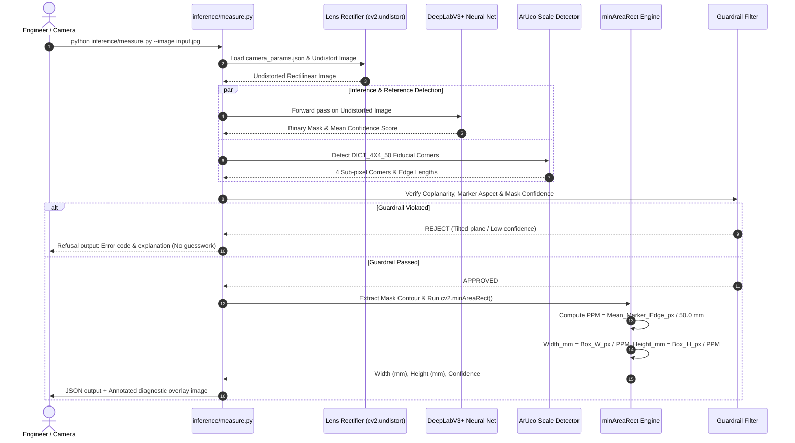
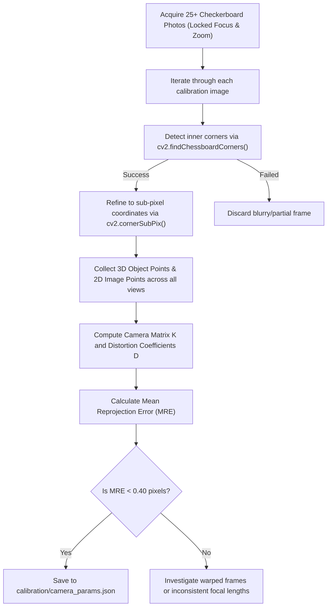
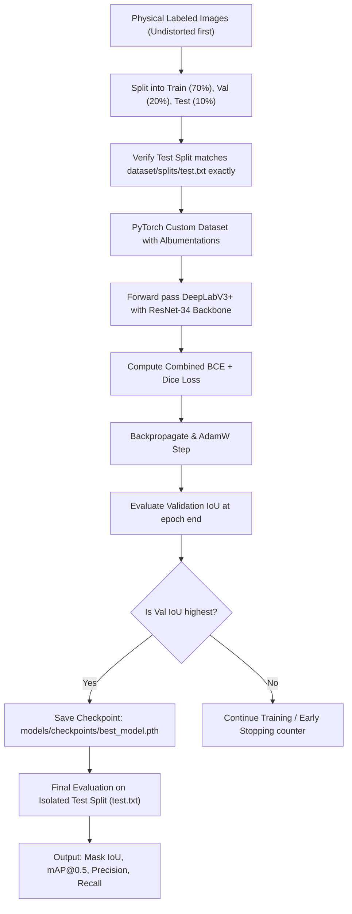

# 🔄 Optical Metrology & System Flows

This document details the operational execution flows, state machines, and mathematical transformations inside **Measure-It**.

---

## 1. Single Command Metrology Execution Flow (`inference/measure.py`)

---

## 2. Camera Calibration Flow (`calibration/calibrate.py`)

---

## 3. Training & Evaluation Flow (`models/`)

---

## 4. Defensive Guardrail Decision Table

| Failure Trigger | Detection Mechanism | System Action | Exit Code |
|---|---|---|---|
| **No Target Object** | Mask area $< 500\text{ px}$ | Refuse to output dimensions; advise retaking photo | `ERR_OBJECT_NOT_FOUND` |
| **No Reference Marker** | `cv2.aruco.detectMarkers` returns zero markers | Refuse to output dimensions; scale cannot be determined | `ERR_REFERENCE_NOT_FOUND` |
| **Severe Perspective Tilt** | Ratio of max/min ArUco sides $> 1.08$ ($> 20^\circ$ tilt) | Refuse to answer; perspective foreshortening invalidates scale | `ERR_TILT_EXCEEDED` |
| **Low Model Confidence** | Mean sigmoid prediction activation on mask $< 0.85$ | Refuse to answer; segmentation boundary uncertain | `ERR_LOW_CONFIDENCE` |
| **Object Near Frame Edge** | Bounding box within 10 pixels of image border | Refuse to answer; partial truncation suspected | `ERR_EDGE_TRUNCATION` |
