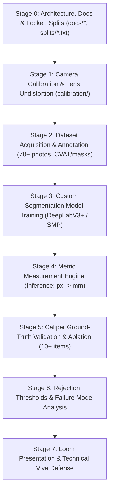

# Measure-It: Industrial Object Measurement System
## Comprehensive Master Blueprint & Step-by-Step Implementation Roadmap

> **Target Assessment**: AI / Computer Vision Technical Assessment — `xis.ai`  
> **Prepared For**: Candidate Workflow & Architecture Specification  
> **Status**: Planning & Architecture Phase (Zero Code Baseline)  
> **Repository Branch**: `dev-test01`

---

## 1. Executive Summary & Assessment Scope

This project implements an end-to-end industrial optical metrology system that takes a single photograph of a physical object, compensates for optical distortions, identifies the object using semantic segmentation, detects a co-planar metric reference object, and computes the real-world dimensions (width and height in millimeters) alongside an uncertainty confidence score.

### Key Evaluation Criteria
1. **Physical & Mathematical Rigor**: Correct camera pinhole model, radial/tangential undistortion, metric scale factor calculation, and caliper verification.
2. **Defensive Computer Vision**: Knowing when **not** to answer (rejecting low confidence masks, non-coplanar tilt, obscured references).
3. **Strict Git Discipline**:
   - Work strictly on branch `dev-test01`.
   - Commit the **Plan** and **test split list** *before* any code is written.
   - Commit in logical stages with clear imperative messages (Calibration → Data → Training → Measurement).
   - Absolute ban on single massive commits or committing finished pipelines upfront.
4. **Model Architecture Restrictions**:
   - **STRICT PROHIBITION**: Ultralytics YOLO models and Roboflow prepackaged models are disqualified.
   - **Allowed**: Custom PyTorch segmentation architectures (e.g., DeepLabV3+, U-Net, FPN) with pretrained standard backbones (ResNet34, ResNet50, EfficientNet-B0).
5. **Video Proof**: 5-minute Loom screen/webcam recording demonstrating real-time caliper verification, code walkthrough, and answering the 4 core viva questions (K1–K4).

---

## 2. Hard Disqualification Checklist (Must Avoid)

| Failure Mode | Reason for Instant Rejection | Prevention Measure |
|---|---|---|
| Missing any document in `docs/` | `Plan.md`, `Objectives.md`, `Definition_of_Done.md`, and root `README.md` are mandatory. | All 3 docs + README created & committed first. |
| YOLO or Roboflow models used | Prohibited by Section 4.2 / Section 9. | Use PyTorch `segmentation_models_pytorch` with DeepLabV3+ (ResNet34 backbone). |
| Massive / single end-commit | Prohibited by Section 5.1 / Section 9. | Structured, multi-commit progressive Git history on `dev-test01`. |
| Uncommitted test split before training | Test set leakage invalidates metric claims. | Commit `dataset/splits/test.txt` in initial commit. |
| Downloaded object images | Every image must be physically taken by candidate. | Shoot 70+ personal photos using locked camera focus/zoom. |
| Missing undistortion proof | Section 3 item 6 demands real empirical numbers. | Run side-by-side evaluation: Raw vs Undistorted error delta. |
| Unjustified numbers or unticked DoD | Numbers without hardware specs or raw output proof are rejected. | Record hardware specs, raw terminal logs, and caliper table. |
| Loom video > 5 minutes | Strictly capped at 5:00 max. | Rehearse timing: 1m live demo, 1.5m code walkthrough, 2.5m 4 questions. |

---

## 3. Physical Equipment & Setup Choices

1. **Camera Device**:
   - Smartphone or external webcam locked at fixed zoom (1.0x optical), fixed autofocus (`AE/AF Lock`), and fixed resolution ($1920 \times 1080$ or $4032 \times 3024$).
   - Reason: Auto-focus and optical zoom dynamically alter focal length $f_x, f_y$ and principal point $c_x, c_y$, which invalidates camera matrix calibration.
2. **Calibration Pattern**:
   - Standard OpenCV Checkerboard pattern ($9 \times 7$ internal vertices, square size measured with digital caliper: e.g., $25.0 \text{ mm}$).
   - Mounted on a flat rigid foam board or hard clipboard (no bending/warping).
3. **Reference Object**:
   - OpenCV ArUco Marker (Dictionary: `DICT_4X4_50`, ID: 0, physical size: $50.0 \times 50.0 \text{ mm}$ measured with caliper).
   - Alternatively: Standard precision coin or credit card ($85.60 \times 53.98 \text{ mm}$). ArUco is preferred due to robust sub-pixel corner detection and automatic orientation invariance.
4. **Target Physical Object to Measure**:
   - Flat, rigid object with measurable orthogonal edges (e.g., rigid rectangular phone battery, metallic ID card badge, or precision machined block, approximately $60 \text{ mm} \times 90 \text{ mm}$).
   - Ground truth measured independently using a digital caliper (resolution: $\pm 0.02 \text{ mm}$).

---

## 4. Technology Stack & Library Selection

| Library | Version | Role in Project | Justification |
|---|---|---|---|
| `python` | `3.10` or `3.11` | Runtime Environment | High compatibility with modern ML & CV wheels. |
| `opencv-python` | `~4.10.0` | Calibration, ArUco & Geometry | Industry gold standard for `cv2.calibrateCamera`, `cv2.undistort`, sub-pixel corner detection, and contour analysis. |
| `torch` | `~2.4.0` | Deep Learning Engine | Clean, modular tensor execution for training custom neural network. |
| `torchvision` | `~0.19.0` | Vision Models & Transforms | Pretrained backbones and image preprocessing transforms. |
| `segmentation-models-pytorch` | `~0.3.4` | Model Architecture | Provides standard PyTorch implementations of DeepLabV3+ and U-Net with ResNet34 backbones without any YOLO/Roboflow dependencies. |
| `albumentations` | `~1.4.15` | Geometric & Photometric Augmentation | Synchronous image-and-mask augmentations without introducing artificial scale distortions. |
| `numpy` | `~1.26.4` | Numerical Metrology | Linear algebra, Euclidean distance calculations, bounding box math. |
| `scipy` | `~1.13.0` | Spatial Math & Statistics | Minimum bounding boxes, convex hulls, error metrics. |
| `matplotlib` | `~3.9.0` | Plotting & Diagnostics | Loss curves, IoU plots, raw vs undistorted overlay figures. |
| `tqdm` | `~4.66.5` | Progress Indication | Clean CLI training and evaluation loops. |
| `pyyaml` | `~6.0.2` | Configuration Management | Deterministic parameters for calibration, training, and thresholds. |

---

## 5. End-to-End Implementation Stages (A to Z)



### Stage 0: Documentation & Frozen Split Setup (Rule 5.1 & 5.3)
- Author `docs/Plan.md` outlining the 8-hour schedule, priorities, and decision records.
- Author `docs/Objectives.md` specifying measurable targets (MO-1: Measurement MAE $\le 1.5\text{ mm}$, MO-2: Mask test IoU $\ge 0.88$).
- Author `docs/Definition_of_Done.md` setting strict verification acceptance criteria.
- Commit the fixed train/val/test splits (`dataset/splits/test.txt`, etc.) **before writing any pipeline code**.

### Stage 1: Camera Calibration & Optical Undistortion
- Capture 25+ images of the calibration checkerboard at diverse angles, tilts, and frame positions (including extreme edges).
- Execute OpenCV camera calibration:
  - Extract inner corners using `cv2.findChessboardCorners()` and refine with `cv2.cornerSubPix()`.
  - Calculate intrinsic camera matrix $K$ and distortion coefficients $D = [k_1, k_2, p_1, p_2, k_3]$.
  - Compute and log overall Mean Reprojection Error (MRE target: $< 0.4 \text{ px}$).
  - Save parameters to `calibration/camera_params.json`.
- Implement `undistort(img)` function using `cv2.undistort()` with optimal new camera matrix (`cv2.getOptimalNewCameraMatrix`).

### Stage 2: Dataset Acquisition & Labeling
- Capture 75-80 high-resolution images of the target object under varied indoor lighting, positions, and backgrounds.
- Preprocess: Every single training/evaluation image is undistorted first using the calibrated camera parameters.
- Annotate exact binary segmentation masks (polygon outlines) using CVAT or Label Studio.
- Partition images strictly according to pre-committed split lists:
  - **Train**: 70% (~56 images)
  - **Validation**: 20% (~16 images)
  - **Test**: 10% (~8 images) — strictly isolated, never seen during training or tuning.

### Stage 3: Custom Semantic Segmentation Model
- Architecture: **DeepLabV3+** with **ResNet-34** backbone pretrained on ImageNet (implemented via `segmentation_models_pytorch`).
- Justification: Atrous Spatial Pyramid Pooling (ASPP) captures multi-scale contextual features with sharp boundary delineation, outperforming standard U-Nets on thin/orthogonal industrial contours, while strictly adhering to the "No Ultralytics / No Roboflow" constraint.
- Loss Function: Combined Binary Cross-Entropy + Dice Loss:
  $$\mathcal{L} = \mathcal{L}_{\text{BCE}} + \mathcal{L}_{\text{Dice}}$$
- Training Regimen: AdamW optimizer, Cosine Annealing learning rate schedule, early stopping based on validation IoU.
- Test Split Evaluation:
  - Mask Intersection over Union (IoU)
  - Mean Average Precision (mAP@0.5 and mAP@0.5:0.95)
  - Precision and Recall

### Stage 4: Single-Command Image-to-Millimetres Pipeline
Implement `inference/measure.py`:
1. **Input**: Image path (raw photograph).
2. **Step A (Undistortion)**: Correct lens distortion using stored $K$ and $D$.
3. **Step B (Segmentation)**: Pass undistorted image to trained DeepLabV3+ model; obtain binary prediction mask and model confidence.
4. **Step C (Reference Detection)**: Detect ArUco marker using `cv2.aruco.detectMarkers()` or detect known fiducial reference.
   - Extract sub-pixel corners of the reference square.
   - Calculate pixel dimension of the reference marker: $S_{\text{ref, px}} = \frac{1}{4} \sum_{i=1}^4 d(p_i, p_{i+1})$.
   - Compute spatial scale factor:
     $$\text{PPM} = \frac{S_{\text{ref, px}}}{\text{Dimension}_{\text{ref, mm}}} \quad [\text{pixels per mm}]$$
5. **Step D (Object Dimension Extraction)**:
   - Extract primary contour from the predicted object mask.
   - Compute minimum area oriented bounding box (`cv2.minAreaRect(contour)`).
   - Convert bounding rectangle pixel length and width to millimeters:
     $$\text{Width}_{\text{mm}} = \frac{\text{Width}_{\text{px}}}{\text{PPM}}, \quad \text{Height}_{\text{mm}} = \frac{\text{Height}_{\text{px}}}{\text{PPM}}$$
6. **Step E (Error Handling & Guardrails)**:
   - Handle Case 1: *Object not found* (mask area < min threshold or confidence < threshold) $\rightarrow$ Exit gracefully with clear error code.
   - Handle Case 2: *Reference not found* $\rightarrow$ Exit gracefully without guessing.
   - Generate diagnostic overlay image displaying mask contours, reference marker, and dimension annotations.

### Stage 5: Caliper Ground-Truth Validation & Ablation Studies
1. **Accuracy Evaluation (10+ Instances)**:
   - Measure 10+ distinct test physical placements using digital caliper ground truth.
   - Compare system measurements against ground truth.
   - Compute Mean Absolute Error (MAE):
     $$\text{MAE} = \frac{1}{N} \sum_{i=1}^N |y_i - \hat{y}_i|$$
   - Compute Mean Percentage Error (MPE):
     $$\text{MPE} = \frac{1}{N} \sum_{i=1}^N \frac{|y_i - \hat{y}_i|}{y_i} \times 100\%$$
2. **Empirical Proof That Undistortion Matters (Item 6)**:
   - Run the exact measurement pipeline on the **raw (distorted)** test images vs the **undistorted** images.
   - Record side-by-side comparative error tables showing how radial barrel/pincushion distortion skews pixel-to-millimeter ratios (especially when the reference or object lies towards frame edges).

### Stage 6: Defense Against Failure Modes & Rejection Logic (Item 8 & 9)
- **Breaking Condition Experiment (Item 8)**: Select **Camera Perspective Tilt** ($0^\circ, 15^\circ, 30^\circ, 45^\circ$).
  - As non-coplanar tilt increases, perspective foreshortening invalidates uniform PPM scaling.
  - Plot error growth as a function of tilt angle.
- **Knowing When Not to Answer (Item 9)**:
  - Reject images when reference marker aspect ratio deviates from 1.0 (indicating excessive camera tilt $\ge 20^\circ$).
  - Reject masks with low prediction certainty (sigmoid confidence $< 0.85$) or non-smooth boundary artifacts.
  - Tabulate how many invalid/marginal images are safely rejected vs allowed.

### Stage 7: The 5-Minute Loom Presentation & Interview Defense
Strict script structure for 5-minute Loom:
- **0:00 - 1:00 (Live Demonstration)**: Capture fresh photo, run CLI command on screen, show instant overlay and printed mm dimensions, compare directly with physical caliper measurement on camera.
- **1:00 - 2:30 (Code Architecture Walkthrough)**: Trace the image path through code: undistort $\rightarrow$ PyTorch segmentation inference $\rightarrow$ ArUco corner detection & PPM calculation $\rightarrow$ minAreaRect conversion.
- **2:30 - 5:00 (Direct Answers to The Four Mandatory Questions)**:
  - **K1**: Which file and line turns pixels into millimetres? What physical coplanarity and lighting assumptions must hold true?
  - **K2**: Where in the code is undistortion applied, and what was the measured error delta between raw vs undistorted images?
  - **K3**: What architectural decision would you reverse if given more time, and what would that change cost?
  - **K4**: Name one technical roadblock or unexpected nuance encountered during calibration/segmentation, and how you resolved it.

---

## 6. Directory Layout & Artifact Organization

```text
Measure-It/
├── .serena/                      # Serena Agent Memory & Architecture Directives
│   └── memories/
│       ├── core.md               # Metrology principles, conventions, rules
│       ├── cv_pipeline.md        # Calibration, undistortion & scale math
│       └── validation.md         # Caliper benchmarking & ablation protocols
├── graphify/                     # Graphify Knowledge Graph artifacts & schema
│   └── README.md                 # Graph generation & architecture query guide
├── calibration/                  # Camera Calibration Modules
│   ├── images/                   # 20+ checkerboard calibration captures
│   ├── calibrate.py              # Calibration calculation script
│   └── camera_params.json        # Calibrated K matrix, dist coeffs, MRE
├── dataset/                      # Dataset & Partitions
│   ├── images/                   # Raw & undistorted object photos
│   ├── labels/                   # Binary segmentation masks (PNG)
│   └── splits/
│       ├── train.txt             # 70% committed partition
│       ├── val.txt               # 20% committed partition
│       └── test.txt              # 10% committed partition (FROZEN FIRST)
├── models/                       # Segmentation Model Training
│   ├── dataset.py                # PyTorch Dataset & Albumentations pipeline
│   ├── model.py                  # DeepLabV3+ architecture definition
│   ├── train.py                  # Training loop with validation checkpoints
│   └── evaluate.py               # Mask IoU, mAP, precision, recall calculation
├── inference/                    # Production Image-to-Millimetre Command
│   ├── measure.py                # Standalone CLI: python inference/measure.py --image <path>
│   └── utils.py                  # Geometric transforms, ArUco detection, drawing
├── measurement/                  # Empirical Validation & Stress Testing
│   ├── benchmark_accuracy.py     # 10+ instances caliper comparison
│   ├── ablation_undistort.py     # Raw vs Undistorted quantitative proof
│   └── stress_test_tilt.py       # Camera tilt degradation curve
├── docs/                         # The 3 Mandatory Assessment Documents
│   ├── Plan.md                   # 1-page timeline, budget & decision record
│   ├── Objectives.md             # MO-1, MO-2 and hardware environment specs
│   └── Definition_of_Done.md     # Acceptance criteria checklist with evidence links
├── requirements.txt              # Pinned reproducible dependencies
└── README.md                     # Project overview, reproduction commands & results
```

---

## 7. Next Actions for Immediate Execution

1. Initialize repository with baseline documentation (`docs/Plan.md`, `docs/Objectives.md`, `docs/Definition_of_Done.md`, and `dataset/splits/test.txt`).
2. Commit this initial setup directly on branch `dev-test01` to establish Git order provenance.
3. Configure Serena project memory (`.serena/`) and Graphify documentation (`graphify/`).
4. Present the complete setup to the user so they can begin capturing calibration images and training data.
